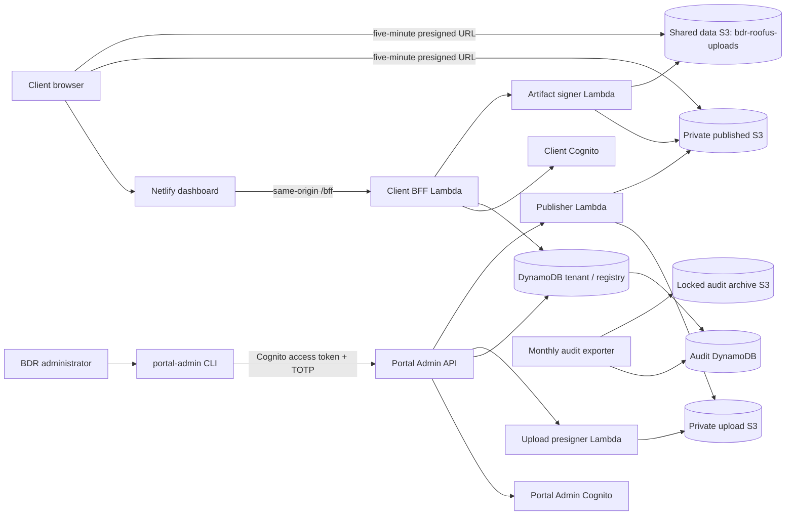

# BDR Inspections Dashboard Architecture

## Purpose and current status

The BDR Inspections Dashboard is the client-facing portal. It has two data paths, described in [backend](./backend.md) and [frontend](./frontend.md).

- **Registry.** DynamoDB projects, inspections, and private portal-bucket PDFs. Staff publish those with the `portal-admin` CLI and the Portal Admin API. ReportGen does not write those tables or buckets.
- **Shared buildings.** ReportGen and this dashboard use `reportgen_portal/org_links.json` and approved report state under `{building}reportgen/client_portal/` on `bdr-roofus-uploads`. The dashboard adds an opaque physical-building/inspection catalog in tenant DynamoDB so multiple source uploads can be grouped deliberately without treating S3 paths as tenant or building identity.

History: [CHANGELOG.md](../CHANGELOG.md). Audit status: [audit-findings.md](../audit-findings.md). Plan: [plan.md](../plan.md).

## System overview



### Environment Isolation & Shared Data Bucket

Development and production are deployed as separate CDK stacks in `us-east-1`. Each environment has dedicated:
- Cognito User Pools and App Clients (client pool and portal admin pool)
- API Gateway APIs and Client BFF / Admin API Lambda functions
- DynamoDB Tables (tenant data, identity mapping, session store, audit log)
- Portal-owned S3 Buckets (private upload staging, published registry storage, locked audit archive)
- KMS customer-managed keys and CloudWatch alarms

> [!WARNING]
> While portal-managed infrastructure is fully isolated between development and production, the operational data bucket `DATA_BUCKET_NAME` (`bdr-roofus-uploads`) is currently **shared** across both environments. Bucket parameterization and isolated dev data storage are deliberately deferred pending coordination with the ReportGen owner. Mutations performed in the development stack directly affect shared-building files in production.

## Domain and visibility model

```text
Organization
├── Client users
├── How to Read document → immutable document versions (registry) or S3 org_links (shared path)
└── Projects / buildings
    └── Inspections / scans
        └── Report categories (Assessment, Evidence, Takeoff, As-built, Capital Planning)
```

Every entity has an opaque ID. A client user belongs to exactly one organization. A project has a required building IANA timezone; every inspection stores an immutable copy of that timezone with its scan time.

Only an active organization, active project, active and published inspection, published report classification, and verified current version can produce a client PDF URL. The same predicate applies to collection routes and direct report access. Missing, foreign, draft, archived, unpublished, or invalid resources resolve to the same client-facing `404`.

The registry report categories are Assessment, Evidence, Roof Takeoff, and Capital Planning. Each published inspection explicitly classifies every category as `PUBLISHED`, `EXPECTED`, `NOT_INCLUDED`, or `NOT_APPLICABLE`. How to Read is an organization-level document and never appears as an inspection report.

In the shared-building catalog path, inspections provide five fixed report types: Roof Assessment, Inspection Evidence, Roof Takeoff, As-built, and Capital Planning, classified as `AVAILABLE`, `IN_PREPARATION`, or `NOT_INCLUDED`.

## Publication and storage

### Registry Path
Manual uploads use a server-generated immutable upload target. The CLI validates file size, `%PDF-` header, and SHA-256, uploads directly to the private upload bucket, then asks the Admin API to verify the exact S3 object version. Only a `READY` upload can publish.

Publication copies the verified source object to an immutable `versions/{versionId}.pdf` key in the private published bucket, verifies the destination, and then commits the registry pointer in DynamoDB. A failed copy or transaction never makes a new version visible. Replacement creates a new version and moves only the logical report's `currentVersionId`; clients never access superseded versions.

The client BFF authorizes a request before the artifact signer issues a five-minute URL. Published objects are private, versioned, KMS-encrypted, and protected by S3 Block Public Access.

### Shared Building Path
The shared path does not publish into the inspection registry. S3 remains the source of approved ReportGen artifacts and upload-completion evidence. The tenant table stores the physical building, ordered inspections, selected source sections, report classifications, optional published As-built artifact, revision, and exclusive source claims.

Clients access reports through `POST /bff/portal/artifact-access` with opaque building, inspection, and report-type identifiers. The server validates caller tenant ownership, verifies report approval (`clientVisible: true`, non-stale, approved key), resolves the underlying S3 key, and issues a 5-minute presigned URL with sanitized filename headers (`Building Name - Report Type.pdf`). Legacy direct file routes (`GET /bff/portal/file`) reject non-admin client sessions with HTTP 403.

Dashboard writes to `org_links.json` and building `status.json` enforce S3 ETags (`If-Match` / `If-None-Match: *`) to detect concurrent updates. Complete writer separation (`reportgen_status.json` vs `portal_state.json`) is deliberately deferred pending ReportGen companion changes.

## Authentication and administration

Client authentication uses Cognito with authorization-code flow or direct password login. The Client BFF stores Cognito tokens server-side and gives the browser only a host-only, secure, HttpOnly opaque session cookie. Every request checks the server-side session, user status, and organization status.

Sign-ins enforce one-email-one-pool across client and administrator pools, resolving client accounts first. Three security hardening fixes are currently planned:
1. **Client Revocation:** Invalidate active sessions in `SESSION_TABLE_NAME` and update `SUBJECT#` records in `IDENTITY_TABLE_NAME` upon client user revocation.
2. **Canonical Administrator Provisioning:** Synchronize BFF admin creation with DynamoDB `AdminProfile` creation, `ADMIN_GUARD` count incrementing, and audit logging to maintain CLI/Admin API operational integrity.
3. **Administrator MFA Onboarding:** Handle multi-step challenge transitions (`MFA_SETUP` / `SOFTWARE_TOKEN_MFA`) following temporary password replacement (`NEW_PASSWORD_REQUIRED`) in `passwordLogin` to eliminate onboarding failures.

The current administration paths:
- The local `portal-admin` CLI signs in through the Portal Admin Cognito pool with TOTP, calling the Portal Admin API.
- Dashboard administrator tools under `/bff/portal/*` approve ReportGen PDFs, link client folders, and manage physical building catalog attachments.
- Admin sessions are distinguished by `admin: true` in `/bff/me`. Non-admin client sessions receive `admin: false`.

## Operational safeguards

All portal DynamoDB tables use point-in-time recovery, customer-managed encryption, deletion protection, and retained removal policies. Audit events are append-only application records with a six-month TTL; EventBridge exports them on the first day of each month to a KMS-encrypted S3 Object Lock archive with 184-day governance retention.

CloudWatch alarms cover Lambda errors/throttles, API 5xx responses, DynamoDB throttles, audit-export failures, EventBridge delivery failures, and forbidden audit mutations. CloudTrail records writes and deletes to the published-object prefix and writes to the audit table.

See [backend](./backend.md), [frontend](./frontend.md), [API contracts](./api-contracts.md), [project layout](./project_layout.md), and the [runbooks](./runbooks/).
