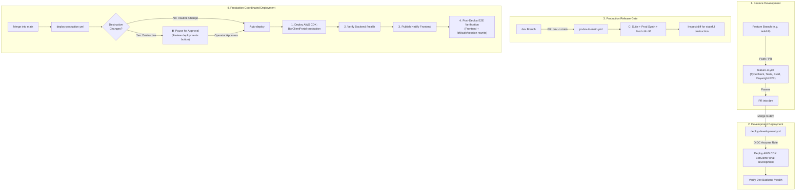

# CI/CD & Deployment Architecture

This document outlines the automated testing, continuous integration, and coordinated deployment pipeline for the BDR Inspections Dashboard.

---

## 1. Architecture & Design Principles

The deployment pipeline is built entirely on **GitHub Actions**, adhering to the following design principles:

1. **Zero Permanent AWS Credentials:** AWS authentication is handled exclusively through **GitHub OpenID Connect (OIDC)** with least-privilege IAM roles. No long-lived access keys or secrets are stored in GitHub.
2. **Coordinated Deployments:** The AWS CDK backend stack must deploy and pass automated zero-side-effect health checks *before* the Netlify frontend is published. Netlify's automatic GitHub webhooks are decoupled via `netlify.toml` ignore rules to eliminate race conditions and mismatched frontend/backend states.
3. **Hybrid Production Approval:** 
   - **Routine changes** (frontend UI, Lambda logic, non-destructive infrastructure updates) auto-deploy to production on merge to `main`.
   - **Destructive changes** targeting stateful infrastructure (`AWS::DynamoDB::Table`, `AWS::Cognito::UserPool`, `AWS::KMS::Key`, `AWS::S3::Bucket`) are automatically detected via an automated `cdk diff` analyzer and gated behind GitHub's native environment approval UI (`production-approval`).
4. **Environment Isolation:** Separate development (`BdrClientPortal-development`) and production (`BdrClientPortal-production`) AWS CDK stacks, each with dedicated IAM roles, Cognito pools, APIs, and DynamoDB tables.
5. **Zero-Side-Effect Health Checks:** Automated deployment verification uses read-only `/health` endpoints on Client BFF and Admin API, plus unauthenticated `/bff/auth/session` Netlify rewrite tests, avoiding test session churn in live Cognito user pools.

---

## 2. Branching & Deployment Strategy

### Branch Roles

| Branch | Purpose | Automatic Actions |
|---|---|---|
| `dev` | Integration & active development branch | Runs full test suite, assumes `AWS_DEV_DEPLOY_ROLE_ARN`, and auto-deploys `BdrClientPortal-development`. |
| `main` | Production branch | Runs full test suite, runs production `cdk diff`, executes hybrid deployment (auto or approval gate), and coordinates AWS + Netlify release. |
| Feature branches | Local & task development | Runs `feature-ci.yml` (quality gate only, zero cloud interactions). |

---

## 3. Workflow Catalog

All workflow files reside in `.github/workflows/`:

### 1. `feature-ci.yml` (CI Quality Gate)
- **Triggers:** Push to feature branches or PRs targeting `dev`.
- **Steps:**
  - Typecheck all workspaces (`npm run typecheck`, `npm run typecheck:e2e`).
  - Unit & contract tests (`npm run test`).
  - Build all workspaces (`npm run build`).
  - Playwright browser install with `actions/cache@v4` and retry resilience.
  - Playwright local E2E suite (`npm run test:e2e`).
  - Development CDK stack synthesis (`npm run cdk:dev:synth`).
- **Cloud access:** None.

### 2. `deploy-development.yml` (Deploy Development)
- **Triggers:** Push to `dev` (skips markdown/doc commits).
- **Concurrency:** Group `cdk-development`, non-canceling.
- **Steps:**
  - Full CI validation suite and CDK synthesis.
  - AWS OIDC authentication assuming `AWS_DEV_DEPLOY_ROLE_ARN`.
  - CDK deployment: `npm run cdk:dev:deploy`.
  - Backend smoke check: Verifies `GET /health` on both Client BFF and Admin API.

### 3. `pr-dev-to-main.yml` (PR Release Gate: dev -> main)
- **Triggers:** Pull requests targeting `main`.
- **Steps:**
  - Full CI validation suite and Production CDK synthesis (`npm run cdk:prod:synth`).
  - AWS OIDC authentication assuming `AWS_PROD_DEPLOY_ROLE_ARN`.
  - Runs `npm run cdk:prod:diff` against live production AWS.
  - Inspects the diff with `check-cdk-diff.ts` for destructive changes to stateful resources.
  - Posts the production infrastructure diff summary directly to the GitHub Action Step Summary.

### 4. `deploy-production.yml` (Deploy Production)
- **Triggers:** Push to `main` or manual `workflow_dispatch`.
- **Concurrency:** Group `cdk-production`, non-canceling.
- **Jobs:**
  1. `validate`: Full CI validation suite and production synthesis.
  2. `diff-check`: Runs production `cdk diff` and detects destructive changes.
  3. `deploy-production`:
     - Dynamically targets environment `production` (routine) or `production-approval` (destructive).
     - Deploys AWS CDK production stack (`npm run cdk:prod:deploy`).
     - Verifies backend `/health` endpoints.
     - Publishes Netlify frontend via `npx --yes netlify deploy --build --prod --filter @bdr/web`.
     - Verifies frontend reachability and the `/bff/auth/session` proxy rewrite.

---

## 4. Hybrid Deployment Policy Details

| Change Type | Trigger | Diff Analysis | Production Action |
|---|---|---|---|
| **Frontend UI only** | PR `dev -> main` | No CloudFormation changes | **Automatic deploy** on merge to `main` |
| **Lambda / API logic** | PR `dev -> main` | In-place code updates, no resource replacement | **Automatic deploy** on merge to `main` |
| **Non-destructive Infra** | PR `dev -> main` | New alarms, policies, or additive resources | **Automatic deploy** on merge to `main` |
| **Documentation / Tests** | PR `dev -> main` | Path filtering skips deployment workflows | **No deployment** |
| **Destructive Infrastructure** | PR `dev -> main` | Replacement or deletion of DynamoDB, Cognito, KMS, or S3 | **Pauses for Approval**; requires operator click in GitHub |

---

## 5. Security Model & IAM Roles

GitHub Actions authenticates via AWS IAM OpenID Connect (`token.actions.githubusercontent.com`):

- **Development Role:** `arn:aws:iam::767397717805:role/bdr-client-dashboard-github-actions-dev`
  - Trust condition: `token.actions.githubusercontent.com:sub` matches `repo:Building-Diagnostic-Robotics/BDR-Client-Dashboard:ref:refs/heads/dev`.
- **Production Role:** `arn:aws:iam::767397717805:role/bdr-client-dashboard-github-actions-prod`
  - Trust condition: `token.actions.githubusercontent.com:sub` matches `repo:Building-Diagnostic-Robotics/BDR-Client-Dashboard:*` (allows `main` pushes and PR checks).
- **Permissions:** Both roles are granted least-privilege permission to assume the CDK bootstrap execution roles (`cdk-hnb659fds-*-role-767397717805-us-east-1`) and read bootstrap SSM parameters.

---

## 6. Operational References

For secret configuration, IAM policies, and disaster recovery, see:
- [GitHub Actions Deployment Runbook](./runbooks/github-actions-deployment.md)
- [Authentication Testing Runbook](./runbooks/authentication-testing.md)
