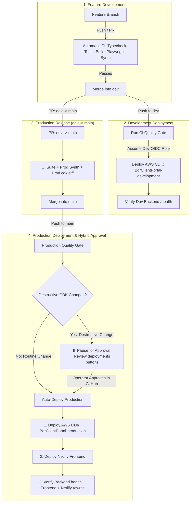

# Runbook: GitHub Actions CI/CD Testing & Coordinated AWS/Netlify Deployments

## Overview

This repository uses GitHub Actions for continuous integration, automated testing, CDK infrastructure synthesis, and coordinated deployments across AWS and Netlify.



---

## 1. AWS IAM OIDC Setup (Account `767397717805`)

GitHub Actions authenticates to AWS using **OpenID Connect (OIDC)**. No permanent IAM access keys are stored in GitHub.

### Step 1.1: Verify or Create GitHub OIDC Identity Provider

In AWS Console:
1. Navigate to **IAM** → **Identity providers**.
2. If `token.actions.githubusercontent.com` already exists, skip to Step 1.2.
3. If not, click **Add provider**:
   - **Provider type:** OpenID Connect
   - **Provider URL:** `https://token.actions.githubusercontent.com`
   - **Audience:** `sts.amazonaws.com`
   - Click **Add provider**.

*AWS CLI equivalent:*
```bash
aws iam create-open-id-connect-provider \
  --url "https://token.actions.githubusercontent.com" \
  --client-id-list "sts.amazonaws.com" \
  --thumbprint-list "6938fd4d98bab03faadb97b34396831e3780aea1" \
  --region us-east-1
```

### Step 1.2: Create Development IAM Role (`BdrDashboard-GitHubActions-Dev`)

This role allows GitHub Actions to deploy `BdrClientPortal-development` only when running on the `dev` branch.

**Trust Policy (`dev-trust-policy.json`):**
Replace `<GITHUB_ORG_OR_USER>` with your GitHub username or organization (e.g. `Building-Diagnostic-Robotics`):
```json
{
  "Version": "2012-10-17",
  "Statement": [
    {
      "Effect": "Allow",
      "Principal": {
        "Federated": "arn:aws:iam::767397717805:oidc-provider/token.actions.githubusercontent.com"
      },
      "Action": "sts:AssumeRoleWithWebIdentity",
      "Condition": {
        "StringEquals": {
          "token.actions.githubusercontent.com:aud": "sts.amazonaws.com"
        },
        "StringLike": {
          "token.actions.githubusercontent.com:sub": "repo:<GITHUB_ORG_OR_USER>/BDR-Client-Dashboard:ref:refs/heads/dev"
        }
      }
    }
  ]
}
```

**Permissions Policy (`cdk-assume-policy.json`):**
Grants permission to assume CDK v2 bootstrap deployment roles in account `767397717805`:
```json
{
  "Version": "2012-10-17",
  "Statement": [
    {
      "Effect": "Allow",
      "Action": ["sts:AssumeRole"],
      "Resource": [
        "arn:aws:iam::767397717805:role/cdk-hnb659fds-*-767397717805-us-east-1"
      ]
    }
  ]
}
```

*AWS CLI creation commands:*
```bash
aws iam create-role \
  --role-name "BdrDashboard-GitHubActions-Dev" \
  --assume-role-policy-document file://dev-trust-policy.json

aws iam put-role-policy \
  --role-name "BdrDashboard-GitHubActions-Dev" \
  --policy-name "CdkBootstrapAssumption" \
  --policy-document file://cdk-assume-policy.json
```

### Step 1.3: Create Production IAM Role (`BdrDashboard-GitHubActions-Prod`)

This role allows GitHub Actions to deploy `BdrClientPortal-production` only when running on the `main` branch.

**Trust Policy (`prod-trust-policy.json`):**
```json
{
  "Version": "2012-10-17",
  "Statement": [
    {
      "Effect": "Allow",
      "Principal": {
        "Federated": "arn:aws:iam::767397717805:oidc-provider/token.actions.githubusercontent.com"
      },
      "Action": "sts:AssumeRoleWithWebIdentity",
      "Condition": {
        "StringEquals": {
          "token.actions.githubusercontent.com:aud": "sts.amazonaws.com"
        },
        "StringLike": {
          "token.actions.githubusercontent.com:sub": "repo:<GITHUB_ORG_OR_USER>/BDR-Client-Dashboard:ref:refs/heads/main"
        }
      }
    }
  ]
}
```

*AWS CLI creation commands:*
```bash
aws iam create-role \
  --role-name "BdrDashboard-GitHubActions-Prod" \
  --assume-role-policy-document file://prod-trust-policy.json

aws iam put-role-policy \
  --role-name "BdrDashboard-GitHubActions-Prod" \
  --policy-name "CdkBootstrapAssumption" \
  --policy-document file://cdk-assume-policy.json
```

---

## 2. Netlify Setup

### Step 2.1: Pause Automatic Git Builds for `main`
To ensure Netlify does not deploy before AWS CDK backend finishes:
1. Log in to [app.netlify.com](https://app.netlify.com).
2. Select the `bdrdashboard` site.
3. Go to **Site configuration** → **Build & deploy** → **Continuous deployment** → **Build settings**.
4. In the **Build status** card, click **Configure** → choose **"Stop builds"** (or pause builds on `main`).
*(Note: `netlify.toml` in the repository root also includes an `ignore` directive to skip git pushes automatically).*

### Step 2.2: Retrieve Netlify Credentials
1. **Site ID:** Under **Site configuration** → **General** → **Site details**, copy the **Site ID** (UUID format).
2. **Personal Access Token:**
   - Click your user profile avatar (top right corner of Netlify) → **User settings**.
   - Navigate to **Applications** → **OAuth** → **Personal access tokens**.
   - Click **New access token** → description: `github-actions-deploy` → **Generate token**.
   - Copy the generated token immediately.

---

## 3. GitHub Repository Configuration

In your GitHub repository under **Settings**:

### Step 3.1: Add Repository Secrets
Navigate to **Settings** → **Secrets and variables** → **Actions** → **New repository secret**:

| Secret Name | Value |
| --- | --- |
| `AWS_DEV_ROLE_TO_ASSUME` | `arn:aws:iam::767397717805:role/BdrDashboard-GitHubActions-Dev` |
| `AWS_PROD_ROLE_TO_ASSUME` | `arn:aws:iam::767397717805:role/BdrDashboard-GitHubActions-Prod` |
| `NETLIFY_AUTH_TOKEN` | `<Your Netlify personal access token from Step 2.2>` |
| `NETLIFY_SITE_ID` | `<Your Netlify site ID from Step 2.2>` |

### Step 3.2: Configure Approval Environment
Navigate to **Settings** → **Environments** → **New environment**:
1. Name: `production-approval`
2. Check **Required reviewers**.
3. Add your GitHub account as the required reviewer.
4. Click **Save protection rules**.

---

## 4. How the Hybrid Deployment Policy Works

### Routine Changes (Automatic)
When you merge frontend UI refinements, Lambda fixes, or non-destructive infrastructure updates into `main`:
1. `validate` job runs all unit tests, typechecks, builds, and Playwright local E2E tests.
2. `diff-check` job runs `cdk diff` and inspects for stateful replacements.
3. Because no stateful resources are replaced, the workflow routes to `environment: production` and **deploys automatically**:
   - AWS CDK deploys `BdrClientPortal-production`.
   - Backend `/health` is verified on Client BFF and Admin API.
   - Netlify builds and publishes the frontend.
   - Post-deployment smoke tests verify `https://bdrdashboard.netlify.app` and `https://bdrdashboard.netlify.app/bff/auth/session`.

### Destructive Changes (Approval Gate)
If a CDK update would replace or delete a stateful resource (`AWS::DynamoDB::Table`, `AWS::Cognito::UserPool`, `AWS::KMS::Key`, `AWS::S3::Bucket`):
1. `check-cdk-diff` flags the destructive changes and sets `has_destructive_changes=true`.
2. The workflow routes deployment to `environment: production-approval`.
3. GitHub pauses the workflow and displays the **"Review deployments"** button in GitHub Actions.
4. You inspect the CDK diff report, click **"Review deployments"**, check `production-approval`, and click **"Approve and deploy"**.
5. Once approved, the deployment completes the full sequence.

---

## 5. Local Commands Reference

You can run identical synthesis, diff, and deployment commands locally:

```bash
# Development Stack
npm run cdk:dev:synth    # Synthesize dev CloudFormation template
npm run cdk:dev:diff     # Compare local code against deployed dev stack
npm run cdk:dev:deploy   # Deploy development stack to AWS

# Production Stack
npm run cdk:prod:synth   # Synthesize prod CloudFormation template
npm run cdk:prod:diff    # Compare local code against deployed prod stack
npm run cdk:prod:deploy  # Deploy production stack to AWS
```
